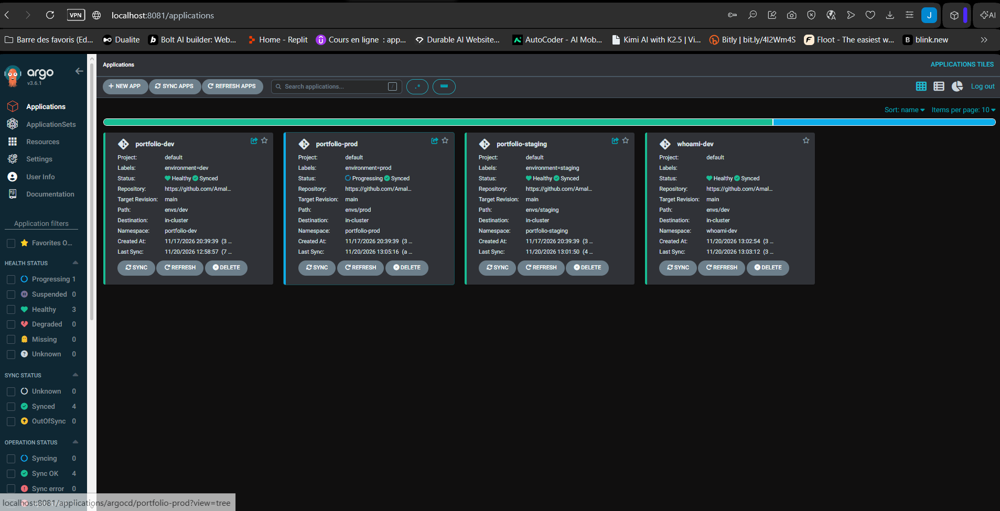
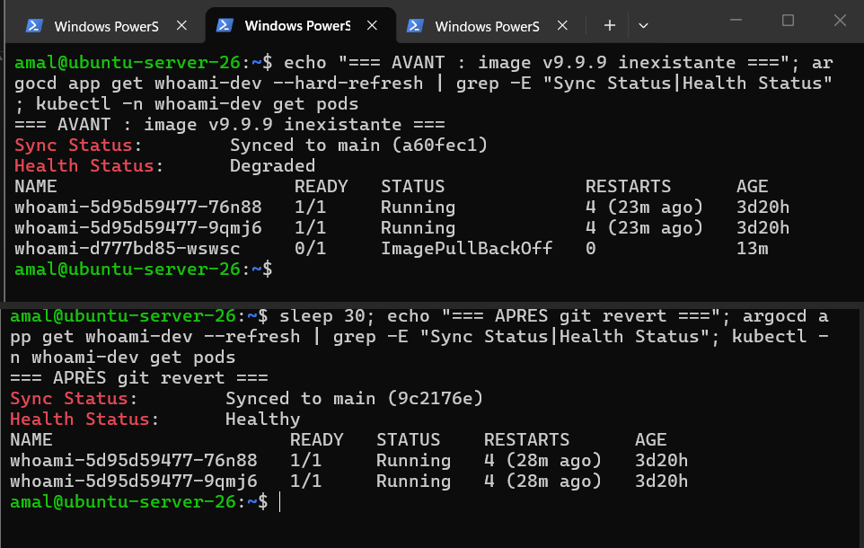
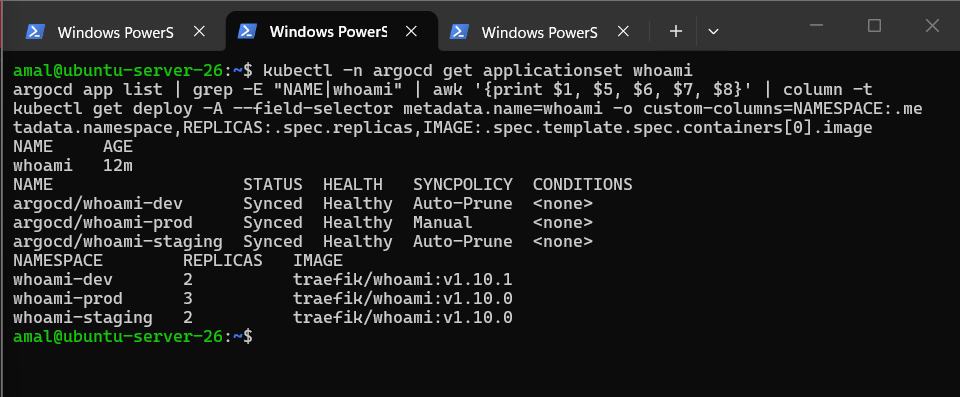
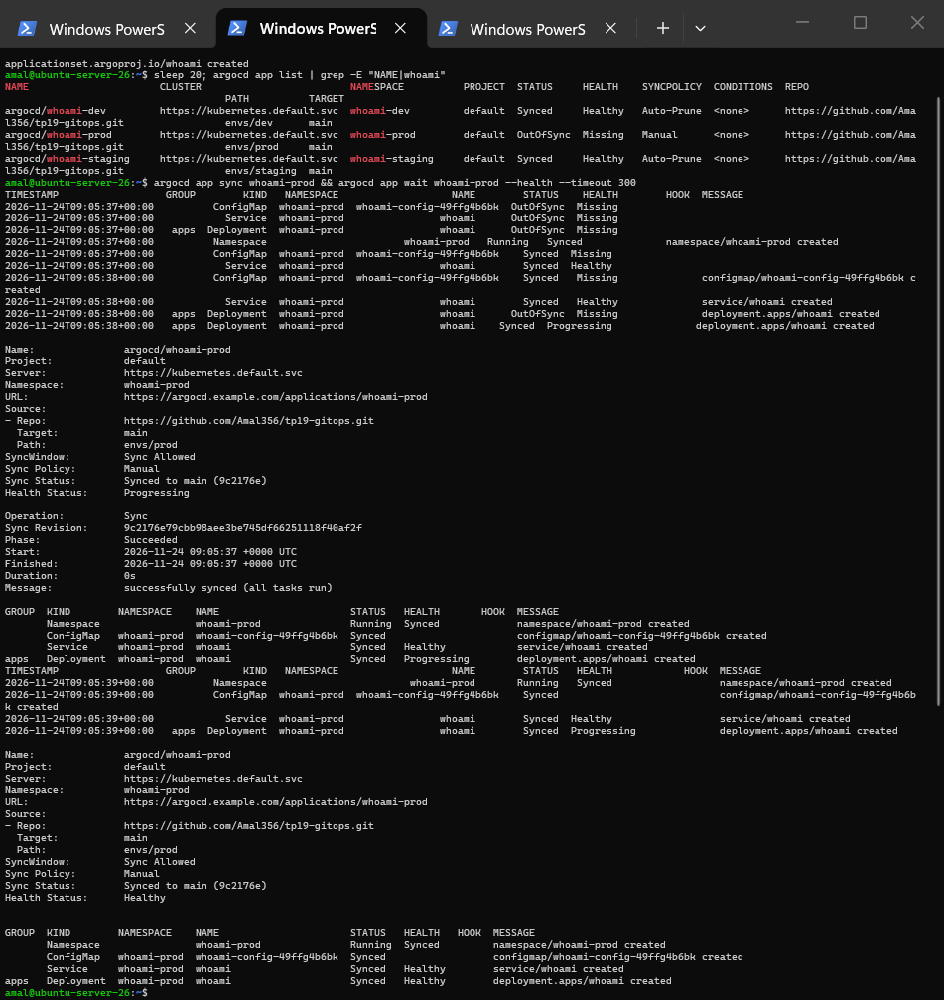
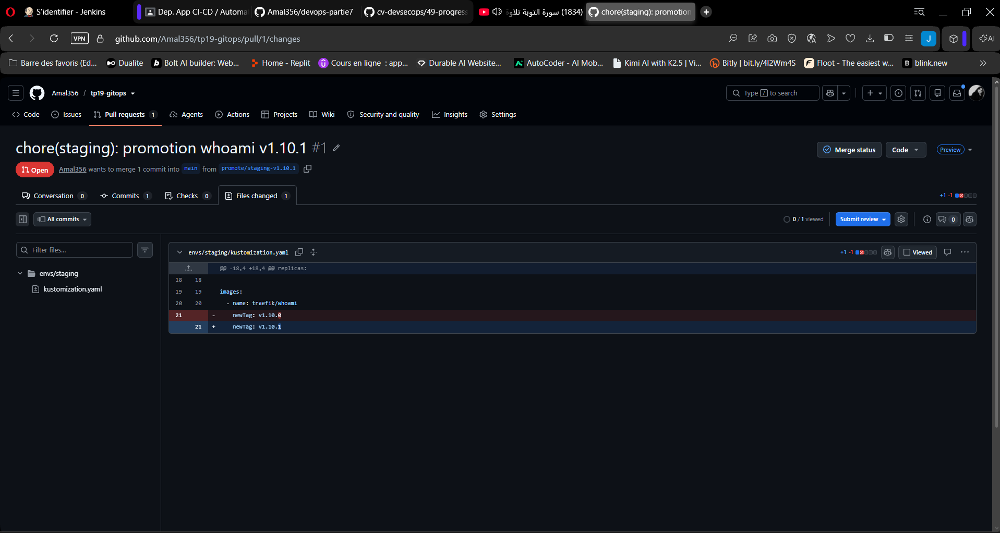
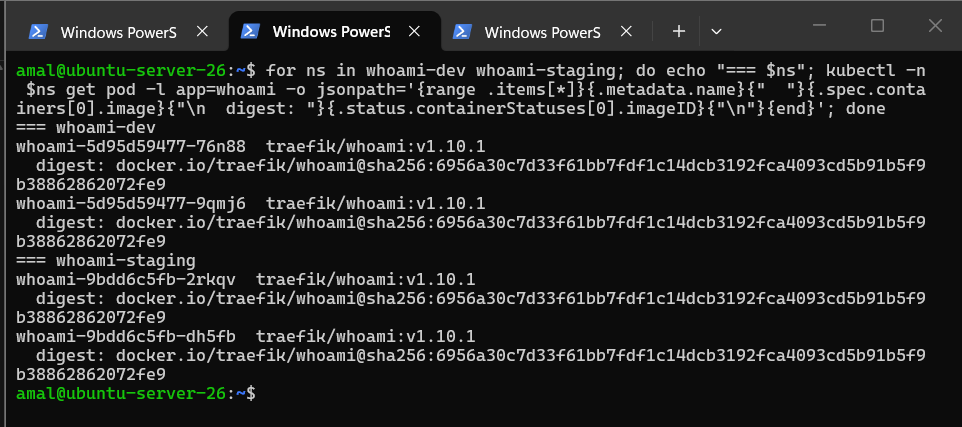

# TP19 : GitOps avec Argo CD (synchronisation, self-healing, ApplicationSet, promotion)

> **Cours** : DevOps & Cloud, M. Wahid ([énoncé](https://docs.teknolabs.net/courses/devops-cloud/partie-7-gitops/tp19-gitops-argocd/))
> **Étudiante** : Amal Jemli, Master DevOps
> **Dépôt GitOps** : [github.com/Amal356/tp19-gitops](https://github.com/Amal356/tp19-gitops)
> **Objectif** : l'état désiré du cluster est déclaré dans Git ; Argo CD le compare en permanence au cluster et le réconcilie. On ne déploie plus avec `kubectl apply`, mais avec un commit ou une Pull Request.

## Sommaire
1. [Les 4 principes GitOps](#1-les-4-principes-gitops)
2. [Environnement](#2-environnement)
3. [Partie 1 : installer Argo CD](#3-partie-1--installer-argo-cd)
4. [Partie 2 : première Application](#4-partie-2--première-application)
5. [Partie 3 : synchronisation automatique, prune, self-healing, rollback](#5-partie-3--synchronisation-automatique-prune-self-healing-rollback)
6. [Partie 4 : ApplicationSet](#6-partie-4--applicationset)
7. [Partie 5 : promotion sans reconstruction](#7-partie-5--promotion-sans-reconstruction)
8. [Difficultés rencontrées](#8-difficultés-rencontrées)
9. [Sécurité](#9-sécurité)
10. [Livrables](#10-livrables)

---

## 1. Les 4 principes GitOps

| Principe (OpenGitOps) | Concrètement dans ce TP |
|---|---|
| **Déclaratif** | l'état désiré est décrit en YAML (Kustomize : `base/` + `envs/*`) |
| **Versionné et immuable** | il est stocké dans Git ([tp19-gitops](https://github.com/Amal356/tp19-gitops)) : historique complet, `git revert` possible |
| **Tiré (pull)** | Argo CD, dans le cluster, **tire** le dépôt (toutes les 3 min) : pas de port entrant, pas d'identifiants du cluster dans la CI |
| **Réconcilié en continu** | Argo CD compare Git et le cluster, et corrige les écarts (*self-heal*, *prune*) |

## 2. Environnement

| Élément | Valeur |
|---|---|
| Cluster | K3s v1.34.12+k3s1, mono-nœud sur la VM de lab (9,2 Go de RAM, disque 76 Go) |
| Argo CD | **v3.6.1**, déjà installé par **Helm** (chart `argo-cd` 10.18.0) pour un autre projet de la VM (ApplicationSet `portfolio`) : **réutilisé** pour ce TP, sans toucher aux Applications existantes |
| CLI `argocd` | v3.6.2, empreinte SHA256 vérifiée (`cli_checksums.txt` : OK) |
| Dépôt GitOps | [Amal356/tp19-gitops](https://github.com/Amal356/tp19-gitops) (public, lu par Argo CD en *pull*) |


## 3. Partie 1 : installer Argo CD

Argo CD était **déjà installé** (Helm, autre activité de la VM). Il est donc **réutilisé** : il ne faut pas lancer une seconde installation par-dessus.

```bash
helm list -A | grep argo                 # argocd  argo-cd-10.18.0  v3.6.1  deployed
kubectl -n argocd get ingress            # argocd-server  traefik  argocd.local  10.0.2.15  80
kubectl -n argocd get cm argocd-cmd-params-cm -o jsonpath='{.data.server\.insecure}'   # true (TLS géré en amont)
# CLI dans une version compatible, empreinte vérifiée
ACV=v3.6.2
curl -fLO https://github.com/argoproj/argo-cd/releases/download/$ACV/argocd-linux-amd64
curl -fLO https://github.com/argoproj/argo-cd/releases/download/$ACV/cli_checksums.txt
grep " argocd-linux-amd64$" cli_checksums.txt | sha256sum -c -      # argocd-linux-amd64: OK
sudo install -m 755 argocd-linux-amd64 /usr/local/bin/argocd
# connexion par l'Ingress Traefik (HTTP, gRPC-web) ; mot de passe lu dans le Secret, jamais affiché
argocd login argocd.local --plaintext --grpc-web --username admin \
  --password "$(kubectl -n argocd get secret argocd-initial-admin-secret -o jsonpath='{.data.password}' | base64 -d)"
```
- `server.insecure=true` : `argocd-server` sert du **HTTP** et laisse le TLS à l'Ingress. D'où `--plaintext --grpc-web` (gRPC-web passe à travers un reverse proxy HTTP comme Traefik).
- Le `port-forward` vers `argocd-server` était coupé (`connection reset by peer`), alors que le Service répondait `ok` depuis un Pod (`wget http://argocd-server.argocd.svc/healthz`). Passer par l'**Ingress existant** a contourné le problème.

## 4. Partie 2 : première Application

```bash
# appliquée depuis GitHub : le fichier vient de la source de vérité
kubectl apply -f https://raw.githubusercontent.com/Amal356/tp19-gitops/main/argocd/application-dev.yaml
argocd app get whoami-dev       # Sync Status: OutOfSync from main (0b2843d) / Health Status: Missing
argocd app diff whoami-dev      # ConfigMap whoami-config-4k87f69b94, Service, Deployment à créer
argocd app sync whoami-dev      # successfully synced (all tasks run), 1 s
argocd app wait whoami-dev --health
kubectl -n whoami-dev get all
```

| Étape | Sync | Health | Explication |
|---|---|---|---|
| Application créée | **OutOfSync** (commit `0b2843d`) | **Missing** | Git décrit des ressources qui n'existent pas dans le cluster |
| `argocd app diff` | — | — | Argo CD a rendu Kustomize (`envs/dev`) et montre ce qu'il va créer, avant d'appliquer |
| `argocd app sync` | Synced | Progressing | namespace `whoami-dev` créé (`CreateNamespace=true`), puis ConfigMap, Service et Deployment |
| après le rollout | **Synced** | **Healthy** | le Pod `whoami` est prêt (1/1) |

- `Sync Policy: Manual` : sans `automated`, Argo CD **détecte** l'écart mais n'agit pas tant qu'on ne lance pas `sync`.
- Le ConfigMap a un **suffixe de hash** (`whoami-config-4k87f69b94`), généré par le `configMapGenerator` de Kustomize. Si son contenu change, son nom change, et les Pods redémarrent.
- Chaque ressource porte l'annotation `argocd.argoproj.io/tracking-id: whoami-dev:…` : c'est ainsi qu'Argo CD sait quelles ressources il gère (et lesquelles il pourra supprimer avec *prune*).
- L'Application `whoami-dev` cohabite avec les Applications `portfolio-*` de l'autre projet, chacune dans ses propres namespaces.

**Interface web** (accès par tunnel SSH depuis Windows : `ssh -p 2222 -L 8081:<ClusterIP argocd-server>:80 amal@127.0.0.1`, puis `http://localhost:8081`) :


- **APP HEALTH : Healthy** et **SYNC STATUS : Synced to main (0b2843d)** : le cluster correspond **exactement** au commit `0b2843d` (« feat: depot GitOps initial »). L'auteur et le message du commit sont affichés : on sait **qui** a déployé **quoi**.
- *Auto sync is not enabled* : synchronisation manuelle à ce stade.
- **Arbre des ressources** : l'Application `whoami-dev` → ConfigMap `whoami-config-4k87f69b94`, Service `whoami`, Deployment `whoami` → ReplicaSet `whoami-5d95d59477` (rev:1) → Pod `whoami-5d95d59477-76n88` (running, 1/1). Argo CD suit aussi les ressources **enfants** créées par Kubernetes (ReplicaSet, Pod), pas seulement celles décrites dans Git.

 *(capture complémentaire : `whoami-dev` à côté des Applications `portfolio-*` d'un autre projet, dans le même Argo CD)*

## 5. Partie 3 : synchronisation automatique, prune, self-healing, rollback

```yaml
# argocd/application-dev.yaml (TODO complété)
syncPolicy:
  syncOptions: [CreateNamespace=true]
  automated:
    prune: true     # ressource supprimée de Git => supprimée du cluster
    selfHeal: true  # modification manuelle du cluster => annulée
```

### Changement par Git

```bash
# Windows : envs/dev/kustomization.yaml -> replicas count: 2, puis
git commit -am "feat(dev): sync automatique (prune, selfHeal) et 2 replicas" && git push      # commit a50674c
# VM : l'Application elle-même est ré-appliquée depuis GitHub
kubectl apply -f "https://raw.githubusercontent.com/Amal356/tp19-gitops/main/argocd/application-dev.yaml?nocache=$(date +%s)"
argocd app get whoami-dev --refresh     # Sync Policy: Automated (Prune) / OutOfSync from main (a50674c) -> Synced
kubectl -n whoami-dev get deploy whoami # 2/2
```
- `--refresh` force la relecture du dépôt (sinon Argo CD le sonde **toutes les 3 minutes**). Un webhook GitHub permettrait une réaction immédiate, mais il faudrait exposer Argo CD sur Internet : en *pull*, on accepte ce délai.
- Le déploiement s'est fait **sans aucun `kubectl apply` sur l'application** : un `git push` suffit.
- `?nocache=…` contourne le cache du CDN de `raw.githubusercontent.com` (environ 5 min).

### Self-healing

```bash
kubectl -n whoami-dev scale deploy whoami --replicas=5     # dérive manuelle
```


- Le `kubectl scale` a bien écrit `spec.replicas: 5`, mais **en moins d'une seconde** Argo CD a détecté l'écart avec Git (`count: 2`) et l'a corrigé. Les **événements** en gardent la trace : `Scaled up replica set whoami-5d95d59477 from 2 to 5`, puis `Scaled down … from 5 to 2`, une seconde plus tard.
- L'Application reste **`Synced to main (a50674c)` / `Healthy`** : **Git a toujours raison**. Une modification faite « en urgence » directement sur le cluster est perdue : il faut passer par un commit.
- Intérêt pour la sécurité : une modification non autorisée (par exemple un attaquant ou une erreur humaine qui change une image ou une ressource) est **annulée automatiquement**, et visible dans les événements et l'historique d'Argo CD.

### Prune

```bash
git rm base/service.yaml && git commit -am "test(prune): suppression du Service" && git push      # commit 41a0855
kubectl -n whoami-dev get svc     # No resources found : le Service a été supprimé du cluster par Argo CD
git revert --no-edit HEAD && git push                                                             # commit d4d13a1
kubectl -n whoami-dev get svc     # whoami ClusterIP 10.43.28.234 (recréé, AGE 10s)
```
- Avec `prune: true`, une ressource **retirée de Git est retirée du cluster**. Sans prune, elle resterait orpheline : `OutOfSync`, mais toujours présente.
- `git revert` **ajoute** un commit d'annulation au lieu de réécrire l'historique : la suppression et sa correction restent traçables.

### Rollback par Git

```bash
kubectl -n whoami-dev patch deploy whoami -p '{"spec":{"progressDeadlineSeconds":60}}'   # test : échec déclaré après 60 s au lieu de 600 s
# Windows : commit fautif (envs/dev newTag: v9.9.9, tag inexistant) -> a60fec1, git push
argocd app get whoami-dev --hard-refresh     # Synced to main (a60fec1) / Degraded
# Windows : correction PAR GIT
git revert --no-edit HEAD && git push        # 9c2176e
argocd app get whoami-dev --refresh          # Synced to main (9c2176e) / Healthy
```



| Moment | Sync | Health | Pods |
|---|---|---|---|
| Commit fautif `a60fec1` appliqué | Synced to main (a60fec1) | **Degraded** | 2 anciens Pods `Running` + 1 nouveau Pod `whoami-d777bd85-…` en **`ImagePullBackOff`** |
| Après `git revert` (`9c2176e`) | Synced to main (9c2176e) | **Healthy** | les 2 Pods `Running` seulement ; le Pod cassé a disparu |

- **Argo CD a fidèlement appliqué Git, même une erreur** : `Synced` signifie « conforme à Git », pas « fonctionnel ». C'est `Health` qui révèle le problème (`Degraded`), après `ProgressDeadlineExceeded` sur le Deployment.
- **Pas d'interruption de service** : grâce au *rolling update* (`maxUnavailable`), Kubernetes garde les anciens Pods tant que les nouveaux ne sont pas prêts.
- **Correction par Git, pas dans le cluster** : `git revert` crée un commit d'annulation, poussé, puis appliqué automatiquement. L'historique garde la trace de l'erreur **et** de sa correction (qui, quand, quoi).
- **Rollback par l'UI** (*History and rollback*) : impossible tant que `automated` est actif. Argo CD remettrait aussitôt l'état de Git. En GitOps, on corrige dans Git.
- `progressDeadlineSeconds: 60` a été appliqué par `kubectl patch` pour le test. Le champ n'étant pas décrit dans Git, Argo CD ne l'écrase pas. En production, il serait déclaré dans `base/deployment.yaml` pour détecter vite un déploiement bloqué.
- Plusieurs essais ont été nécessaires (commits `Reapply`/`Revert` dans l'historique) : la réparation avait été poussée **avant** que l'état `Degraded` n'apparaisse (délai par défaut de 600 s). Ce sont des erreurs de manipulation, mais l'historique Git les rend **toutes visibles et réversibles**.

## 6. Partie 4 : ApplicationSet

```yaml
# argocd/applicationset.yaml (TODO complété) : générateur git "directories" -> une Application par envs/*
generators:
  - git:
      repoURL: https://github.com/Amal356/tp19-gitops.git
      revision: main
      directories: [{ path: envs/* }]
template:
  metadata: { name: "whoami-{{ .path.basename }}" }
  spec: { source: { path: "{{ .path.path }}" }, destination: { namespace: "whoami-{{ .path.basename }}" } }
# sync automatique pour dev et staging, MANUELLE pour la prod
templatePatch: |
  {{- if ne .path.basename "prod" }}
  spec:
    syncPolicy:
      automated: { prune: true, selfHeal: true }
  {{- end }}
```

```bash
argocd app delete whoami-dev --cascade=false -y      # l'Application manuelle est retirée, ses ressources restent
kubectl apply -f "https://raw.githubusercontent.com/Amal356/tp19-gitops/main/argocd/applicationset.yaml?n=$(date +%s)"
argocd app list                                      # whoami-dev / whoami-staging : Auto-Prune ; whoami-prod : Manual, OutOfSync / Missing
argocd app sync whoami-prod && argocd app wait whoami-prod --health    # déploiement de la prod décidé par une personne
```



| Application (générée) | Politique | Namespace | Réplicas | Image |
|---|---|---|---|---|
| `whoami-dev` | **Auto-Prune** (automated + prune + selfHeal) | `whoami-dev` | 2 | `traefik/whoami:v1.10.1` |
| `whoami-staging` | **Auto-Prune** | `whoami-staging` | 2 | `traefik/whoami:v1.10.0` |
| `whoami-prod` | **Manual** | `whoami-prod` | 3 | `traefik/whoami:v1.10.0` |

- **Un seul ApplicationSet** (`whoami`) génère les 3 Applications à partir des dossiers `envs/*`. Ajouter un environnement revient à créer un dossier dans Git. Le nom (`whoami-<dossier>`), le chemin et le namespace sont calculés par les **templates Go**.
- **Une seule base, des différences par environnement** : Kustomize (`envs/*/kustomization.yaml`) fixe pour chacun le nombre de réplicas, la version de l'image et `WHOAMI_NAME`.
- `--cascade=false` : supprimer l'Application `whoami-dev` créée à la main **n'a pas supprimé** ses ressources. L'ApplicationSet a recréé une Application du même nom, qui les a reprises sans interruption.

**Quels environnements synchroniser automatiquement ?** dev et staging en **automatique** (déploiement rapide, erreurs sans gravité) ; la **prod en manuel** : après le merge de la PR, une personne déclenche le `sync` au moment choisi (fenêtre de maintenance, équipe disponible). On l'a vu : à sa création, `whoami-prod` est restée **OutOfSync / Missing** jusqu'au `argocd app sync`.

**Comment l'exprimer dans un ApplicationSet ?**
1. **`templatePatch`** (solution retenue) : un bloc Go template ajouté au modèle, ici `{{- if ne .path.basename "prod" }}` → `automated` pour tout sauf la prod.
2. **Générateur `list`** avec un paramètre par environnement (`{env: dev, auto: "true"}`, `{env: prod, auto: "false"}`), utilisé dans le `templatePatch`.
3. Ou garder `automated` partout et ajouter une **fenêtre de synchronisation** (`syncWindows` de l'AppProject) qui interdit les synchronisations de la prod en dehors des créneaux autorisés.

 *(capture complémentaire : `whoami-prod` OutOfSync/Missing puis synchronisée manuellement)*

## 7. Partie 5 : promotion sans reconstruction

### Promotion dev → staging par Pull Request

```powershell
git switch -c promote/staging-v1.10.1
# envs/staging/kustomization.yaml : newTag v1.10.0 -> v1.10.1 (équivalent de : kustomize edit set image traefik/whoami:v1.10.1)
git diff                          # une seule ligne modifiée
git commit -am "chore(staging): promotion whoami v1.10.1"
git push -u origin HEAD           # puis PR #1 sur GitHub, relecture, merge
```



- La PR **#1** (`promote/staging-v1.10.1` → `main`) contient **1 commit, 1 fichier, 1 ligne** : `newTag: v1.10.0` → `newTag: v1.10.1`. La relecture porte exactement sur **ce qui va changer en staging**.
- Après le merge (commit `880dded` sur `main`), Argo CD a synchronisé staging **automatiquement** : `whoami-staging` → `Synced to main (880dded)` / `Healthy`.

### Même image, même digest

```bash
for ns in whoami-dev whoami-staging; do
  kubectl -n $ns get pod -l app=whoami -o jsonpath='{range .items[*]}{.metadata.name}  {.spec.containers[0].image}  {.status.containerStatuses[0].imageID}{"\n"}{end}'
done
```



| Environnement | Pods | Image | Digest |
|---|---|---|---|
| dev | `whoami-5d95d59477-76n88`, `-9qmj6` | `traefik/whoami:v1.10.1` | `sha256:6956a30c7d33f61bb7fdf1c14dcb3192fca4093cd5b91b5f9b38862862072fe9` |
| staging | `whoami-9bdd6c5fb-2rkqv`, `-dh5fb` | `traefik/whoami:v1.10.1` | `sha256:6956a30c7d33f61bb7fdf1c14dcb3192fca4093cd5b91b5f9b38862862072fe9` |

- **Digest identique** en dev et en staging : c'est **le même artefact, octet pour octet**. On n'a rien reconstruit : on a seulement déplacé une **référence** dans Git (*build once, deploy many*). Ce qui a été testé en dev est exactement ce qui tourne en staging.
- Un **tag est mobile** (on peut repousser `v1.10.1` sur une autre image), alors qu'un **digest est immuable** (hash du contenu). Pour une garantie totale, on peut promouvoir par digest (`kustomize edit set image traefik/whoami@sha256:…`), et vérifier la **signature** de ce digest (Cosign, TP12) à l'admission (Kyverno `verifyImages`, TP17).
- Les noms de ReplicaSet diffèrent (`5d95d59477` contre `9bdd6c5fb`) parce que le **ConfigMap** de chaque environnement est différent (`WHOAMI_NAME`), ce qui change le *pod template*. L'**image**, elle, est la même.

### Promotion staging → prod (synchronisation manuelle)

```powershell
git switch main && git pull && git switch -c promote/prod-v1.10.1
# envs/prod/kustomization.yaml : newTag v1.10.0 -> v1.10.1
git commit -am "chore(prod): promotion whoami v1.10.1" && git push -u origin HEAD     # PR #2, merge -> 658de41
```
```text
$ argocd app get whoami-prod --refresh
Sync Status:  OutOfSync from main (658de41)     <- la prod ne se déploie PAS toute seule
Health Status: Healthy                          <- l'ancienne version continue de tourner
$ argocd app sync whoami-prod && argocd app wait whoami-prod --health
deployment.apps/whoami configured   (ConfigMap et Service : unchanged)
Sync Status:  Synced to main (658de41)
Health Status: Healthy
```
- Après le merge, la prod est restée **OutOfSync** : Argo CD a **détecté** le changement, mais ne l'a pas appliqué (`Sync Policy: Manual`). Le déploiement a été **déclenché volontairement**, au moment choisi.
- Seul le Deployment a été modifié (`configured`) : Argo CD n'applique que le **diff**, le ConfigMap et le Service sont `unchanged`.
- La même version v1.10.1 (même digest) a donc traversé dev → staging → prod **sans aucune reconstruction**, avec une PR relue à chaque étape.

### Protection de `main`

Ruleset `protect-main` sur le dépôt `tp19-gitops` (branche par défaut) : **Pull Request obligatoire**, **1 approbation**, **force push interdit**.

**Pourquoi la revue de la PR devient la revue du changement en production ?** En GitOps, `main` **est** l'état désiré du cluster : tout ce qui est fusionné dans `main` est (ou sera, après la synchronisation) déployé par Argo CD. Si aucun commit direct n'est possible sur `main`, la **seule** façon de modifier la production est une PR approuvée par une **autre personne**. La revue de code devient donc le **contrôle de changement** (*change management*) :
- **quatre yeux** : personne ne peut déployer seul ;
- **traçabilité** : la PR conserve qui a proposé, qui a approuvé, quand, et le diff exact ;
- **réversibilité** : `git revert` de la PR fusionnée ;
- **aucun accès direct au cluster** n'est nécessaire pour déployer : seul Argo CD, dans le cluster, applique (modèle *pull*). Les identifiants du cluster ne sortent pas.

> Limite du lab : avec un seul compte GitHub, l'auteure ne peut pas approuver sa propre PR. La règle impose bien une 2ᵉ personne, ce qui est le comportement voulu dans une équipe.

## 8. Difficultés rencontrées

| Problème | Cause | Solution |
|---|---|---|
| `kubectl apply -n argocd --server-side -f install.yaml` : nombreux `conflict with "helm"` | Argo CD était **déjà installé par Helm** sur la VM (autre activité) ; l'apply côté serveur refuse de modifier les champs gérés par Helm | Installation existante réutilisée. `helm rollback argocd 1` ; seul `argocd-notifications-controller` (passé en v3.6.2 par l'apply) a été remis en v3.6.1 avec `kubectl set image`, car Helm ne détectait pas l'écart |
| `argocd login` : `connection refused`, puis port-forward coupé (`connection reset by peer`) | Le port-forward vers `argocd-server` (mode `insecure`) échouait, alors que le Service répondait `ok` | Connexion par l'**Ingress Traefik existant** : `argocd login argocd.local --plaintext --grpc-web` |
| 7 NetworkPolicies `argocd-*-network-policy` en trop | Créées par l'`apply` du manifeste officiel, en plus des 4 NetworkPolicies gérées par Helm | Supprimées une par une (seulement celles sans `app.kubernetes.io/managed-by=Helm`) |

## 9. Sécurité

- **Git, source de vérité unique** : tout changement passe par un commit ou une PR (auteur, date, diff), réversible par `git revert`. Les essais ratés eux-mêmes sont tracés.
- **Modèle pull** : Argo CD, dans le cluster, tire le dépôt **public** en lecture seule. Aucun port entrant vers la VM, aucun webhook, aucun identifiant du cluster dans une CI.
- **Self-heal** : toute modification manuelle (erreur ou malveillance) est **annulée** et visible dans les événements. **Prune** : pas de ressource orpheline.
- **Prod en synchronisation manuelle**, plus **`main` protégée** (PR + 1 approbation + pas de force push) : contrôle humain avant la production.
- **Promotion sans reconstruction** : même digest de dev à prod. Le prolongement naturel est d'épingler le digest et de vérifier sa **signature** (Cosign, TP12) à l'admission (Kyverno `verifyImages`, TP17).
- **Secrets** : le mot de passe admin d'Argo CD n'a jamais été affiché dans les captures ni commité (il est lu dans le Secret `argocd-initial-admin-secret` au moment du login). À faire en production : changer ce mot de passe, supprimer le Secret initial, utiliser le SSO (Dex/OIDC, comme Keycloak au TP16) et le RBAC d'Argo CD (`argocd-rbac-cm`), et isoler chaque équipe dans un **AppProject** (dépôts et namespaces autorisés) au lieu du projet `default`.
- **Plateforme partagée** : l'Argo CD est commun avec un autre projet (`portfolio`). Il a été **réutilisé sans le modifier**, et les écarts introduits par erreur (image du notifications-controller, 7 NetworkPolicies) ont été corrigés. C'est le fonctionnement normal d'un cluster *multi-tenant*.
- CLI `argocd` vérifié par **SHA256**.

## 10. Livrables

| Capture | Contenu | État |
|---|---|---|
| `captures/argocd-synced.png` | Application `whoami-dev` Synced / Healthy dans l'UI | ✅ |
| `captures/self-heal.png` | `kubectl scale` annulé par Argo CD | ✅ |
| `captures/git-revert.png` | Application Degraded puis rétablie après `git revert` | ✅ |
| `captures/applicationset.png` | Trois Applications générées par l'ApplicationSet | ✅ |
| `captures/promotion-pr.png` | Pull Request de promotion vers staging | ✅ |
| `captures/same-digest.png` | Même digest d'image en dev et en staging | ✅ |

Dépôt GitOps avec son historique de commits : [github.com/Amal356/tp19-gitops/commits/main](https://github.com/Amal356/tp19-gitops/commits/main)
