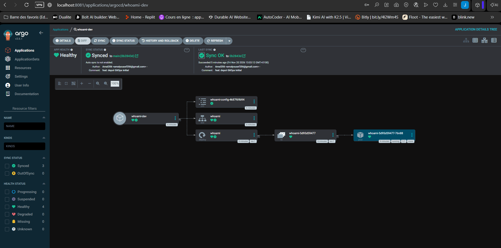
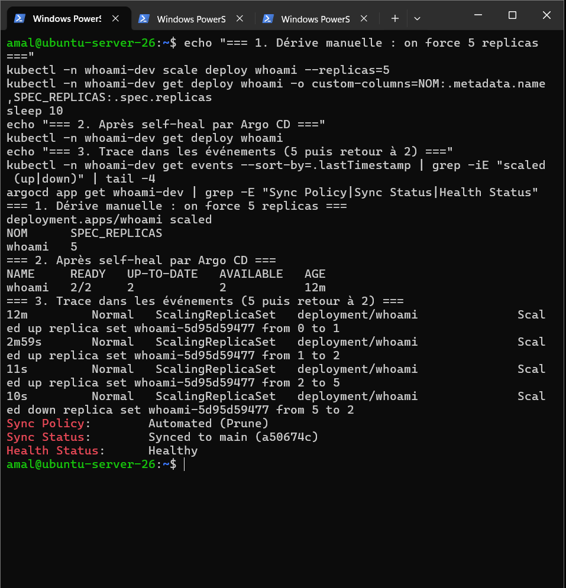

# TP19 : GitOps avec Argo CD (synchronisation, self-healing, ApplicationSet, promotion)

> **Cours** : DevOps & Cloud, M. Wahid ([énoncé](https://docs.teknolabs.net/courses/devops-cloud/partie-7-gitops/tp19-gitops-argocd/))
> **Étudiante** : Amal Jemli, Master DevOps
> **Dépôt GitOps** : [github.com/Amal356/tp19-gitops](https://github.com/Amal356/tp19-gitops)
> **Objectif** : l'état désiré du cluster est déclaré dans Git ; Argo CD le compare en permanence au cluster et le réconcilie. On ne déploie plus avec `kubectl apply`, mais avec un commit ou une Pull Request.

## Sommaire
1. [Les 4 principes GitOps](#1-les-4-principes-gitops)
2. [Environnement](#2-environnement)
3. [Partie 1 : installer Argo CD](#3-partie-1--installer-argo-cd)
4. [Partie 2 : première Application](#4-partie-2--première-application)
5. [Partie 3 : synchronisation automatique, prune, self-healing, rollback](#5-partie-3--synchronisation-automatique-prune-self-healing-rollback)
6. [Partie 4 : ApplicationSet](#6-partie-4--applicationset)
7. [Partie 5 : promotion sans reconstruction](#7-partie-5--promotion-sans-reconstruction)
8. [Difficultés rencontrées](#8-difficultés-rencontrées)
9. [Sécurité](#9-sécurité)
10. [Livrables](#10-livrables)

---

## 1. Les 4 principes GitOps

| Principe (OpenGitOps) | Concrètement dans ce TP |
|---|---|
| **Déclaratif** | l'état désiré est décrit en YAML (Kustomize : `base/` + `envs/*`) |
| **Versionné et immuable** | il est stocké dans Git ([tp19-gitops](https://github.com/Amal356/tp19-gitops)) : historique complet, `git revert` possible |
| **Tiré (pull)** | Argo CD, dans le cluster, **tire** le dépôt (toutes les 3 min) : pas de port entrant, pas d'identifiants du cluster dans la CI |
| **Réconcilié en continu** | Argo CD compare Git et le cluster, et corrige les écarts (*self-heal*, *prune*) |

## 2. Environnement

| Élément | Valeur |
|---|---|
| Cluster | K3s v1.34.12+k3s1, mono-nœud sur la VM de lab (9,2 Go de RAM, disque 76 Go) |
| Argo CD | **v3.6.1**, déjà installé par **Helm** (chart `argo-cd` 10.18.0) pour un autre projet de la VM (ApplicationSet `portfolio`) : **réutilisé** pour ce TP, sans toucher aux Applications existantes |
| CLI `argocd` | v3.6.2, empreinte SHA256 vérifiée (`cli_checksums.txt` : OK) |
| Dépôt GitOps | [Amal356/tp19-gitops](https://github.com/Amal356/tp19-gitops) (public, lu par Argo CD en *pull*) |


## 3. Partie 1 : installer Argo CD

Argo CD était **déjà installé** (Helm, autre activité de la VM). Il est donc **réutilisé** : il ne faut pas lancer une seconde installation par-dessus.

```bash
helm list -A | grep argo                 # argocd  argo-cd-10.18.0  v3.6.1  deployed
kubectl -n argocd get ingress            # argocd-server  traefik  argocd.local  10.0.2.15  80
kubectl -n argocd get cm argocd-cmd-params-cm -o jsonpath='{.data.server\.insecure}'   # true (TLS géré en amont)
# CLI dans une version compatible, empreinte vérifiée
ACV=v3.6.2
curl -fLO https://github.com/argoproj/argo-cd/releases/download/$ACV/argocd-linux-amd64
curl -fLO https://github.com/argoproj/argo-cd/releases/download/$ACV/cli_checksums.txt
grep " argocd-linux-amd64$" cli_checksums.txt | sha256sum -c -      # argocd-linux-amd64: OK
sudo install -m 755 argocd-linux-amd64 /usr/local/bin/argocd
# connexion par l'Ingress Traefik (HTTP, gRPC-web) ; mot de passe lu dans le Secret, jamais affiché
argocd login argocd.local --plaintext --grpc-web --username admin \
  --password "$(kubectl -n argocd get secret argocd-initial-admin-secret -o jsonpath='{.data.password}' | base64 -d)"
```
- `server.insecure=true` : `argocd-server` sert du **HTTP** et laisse le TLS à l'Ingress. D'où `--plaintext --grpc-web` (gRPC-web passe à travers un reverse proxy HTTP comme Traefik).
- Le `port-forward` vers `argocd-server` était coupé (`connection reset by peer`), alors que le Service répondait `ok` depuis un Pod (`wget http://argocd-server.argocd.svc/healthz`). Passer par l'**Ingress existant** a contourné le problème.

## 4. Partie 2 : première Application

```bash
# appliquée depuis GitHub : le fichier vient de la source de vérité
kubectl apply -f https://raw.githubusercontent.com/Amal356/tp19-gitops/main/argocd/application-dev.yaml
argocd app get whoami-dev       # Sync Status: OutOfSync from main (0b2843d) / Health Status: Missing
argocd app diff whoami-dev      # ConfigMap whoami-config-4k87f69b94, Service, Deployment à créer
argocd app sync whoami-dev      # successfully synced (all tasks run), 1 s
argocd app wait whoami-dev --health
kubectl -n whoami-dev get all
```

| Étape | Sync | Health | Explication |
|---|---|---|---|
| Application créée | **OutOfSync** (commit `0b2843d`) | **Missing** | Git décrit des ressources qui n'existent pas dans le cluster |
| `argocd app diff` | — | — | Argo CD a rendu Kustomize (`envs/dev`) et montre ce qu'il va créer, avant d'appliquer |
| `argocd app sync` | Synced | Progressing | namespace `whoami-dev` créé (`CreateNamespace=true`), puis ConfigMap, Service et Deployment |
| après le rollout | **Synced** | **Healthy** | le Pod `whoami` est prêt (1/1) |

- `Sync Policy: Manual` : sans `automated`, Argo CD **détecte** l'écart mais n'agit pas tant qu'on ne lance pas `sync`.
- Le ConfigMap a un **suffixe de hash** (`whoami-config-4k87f69b94`), généré par le `configMapGenerator` de Kustomize. Si son contenu change, son nom change, et les Pods redémarrent.
- Chaque ressource porte l'annotation `argocd.argoproj.io/tracking-id: whoami-dev:…` : c'est ainsi qu'Argo CD sait quelles ressources il gère (et lesquelles il pourra supprimer avec *prune*).
- L'Application `whoami-dev` cohabite avec les Applications `portfolio-*` de l'autre projet, chacune dans ses propres namespaces.

**Interface web** (accès par tunnel SSH depuis Windows : `ssh -p 2222 -L 8081:<ClusterIP argocd-server>:80 amal@127.0.0.1`, puis `http://localhost:8081`) :



- **APP HEALTH : Healthy** et **SYNC STATUS : Synced to main (0b2843d)** : le cluster correspond **exactement** au commit `0b2843d` (« feat: depot GitOps initial »). L'auteur et le message du commit sont affichés : on sait **qui** a déployé **quoi**.
- *Auto sync is not enabled* : synchronisation manuelle à ce stade.
- **Arbre des ressources** : l'Application `whoami-dev` → ConfigMap `whoami-config-4k87f69b94`, Service `whoami`, Deployment `whoami` → ReplicaSet `whoami-5d95d59477` (rev:1) → Pod `whoami-5d95d59477-76n88` (running, 1/1). Argo CD suit aussi les ressources **enfants** créées par Kubernetes (ReplicaSet, Pod), pas seulement celles décrites dans Git.

 *(capture complémentaire : `whoami-dev` à côté des Applications `portfolio-*` d'un autre projet, dans le même Argo CD)*

## 5. Partie 3 : synchronisation automatique, prune, self-healing, rollback

```yaml
# argocd/application-dev.yaml (TODO complété)
syncPolicy:
  syncOptions: [CreateNamespace=true]
  automated:
    prune: true     # ressource supprimée de Git => supprimée du cluster
    selfHeal: true  # modification manuelle du cluster => annulée
```

### Changement par Git

```bash
# Windows : envs/dev/kustomization.yaml -> replicas count: 2, puis
git commit -am "feat(dev): sync automatique (prune, selfHeal) et 2 replicas" && git push      # commit a50674c
# VM : l'Application elle-même est ré-appliquée depuis GitHub
kubectl apply -f "https://raw.githubusercontent.com/Amal356/tp19-gitops/main/argocd/application-dev.yaml?nocache=$(date +%s)"
argocd app get whoami-dev --refresh     # Sync Policy: Automated (Prune) / OutOfSync from main (a50674c) -> Synced
kubectl -n whoami-dev get deploy whoami # 2/2
```
- `--refresh` force la relecture du dépôt (sinon Argo CD le sonde **toutes les 3 minutes**). Un webhook GitHub permettrait une réaction immédiate, mais il faudrait exposer Argo CD sur Internet : en *pull*, on accepte ce délai.
- Le déploiement s'est fait **sans aucun `kubectl apply` sur l'application** : un `git push` suffit.
- `?nocache=…` contourne le cache du CDN de `raw.githubusercontent.com` (environ 5 min).

### Self-healing

```bash
kubectl -n whoami-dev scale deploy whoami --replicas=5     # dérive manuelle
```



- Le `kubectl scale` a bien écrit `spec.replicas: 5`, mais **en moins d'une seconde** Argo CD a détecté l'écart avec Git (`count: 2`) et l'a corrigé. Les **événements** en gardent la trace : `Scaled up replica set whoami-5d95d59477 from 2 to 5`, puis `Scaled down … from 5 to 2`, une seconde plus tard.
- L'Application reste **`Synced to main (a50674c)` / `Healthy`** : **Git a toujours raison**. Une modification faite « en urgence » directement sur le cluster est perdue : il faut passer par un commit.
- Intérêt pour la sécurité : une modification non autorisée (par exemple un attaquant ou une erreur humaine qui change une image ou une ressource) est **annulée automatiquement**, et visible dans les événements et l'historique d'Argo CD.

### Prune

```bash
git rm base/service.yaml && git commit -am "test(prune): suppression du Service" && git push      # commit 41a0855
kubectl -n whoami-dev get svc     # No resources found : le Service a été supprimé du cluster par Argo CD
git revert --no-edit HEAD && git push                                                             # commit d4d13a1
kubectl -n whoami-dev get svc     # whoami ClusterIP 10.43.28.234 (recréé, AGE 10s)
```
- Avec `prune: true`, une ressource **retirée de Git est retirée du cluster**. Sans prune, elle resterait orpheline : `OutOfSync`, mais toujours présente.
- `git revert` **ajoute** un commit d'annulation au lieu de réécrire l'historique : la suppression et sa correction restent traçables.

### Rollback par Git
> 🟡 En cours : commit fautif `5022e4c` (`whoami v9.9.9`, tag inexistant) → nouveau Pod en `ImagePullBackOff`, les 2 anciens Pods continuent de servir (rolling update) → `git revert` (`7598623`) → retour automatique à `Healthy`. Capture `git-revert.png` à refaire avec l'état **Degraded** visible (délai `progressDeadlineSeconds` ramené à 60 s pour le test).

## 6. Partie 4 : ApplicationSet
> ⏳

## 7. Partie 5 : promotion sans reconstruction
> ⏳

## 8. Difficultés rencontrées

| Problème | Cause | Solution |
|---|---|---|
| `kubectl apply -n argocd --server-side -f install.yaml` : nombreux `conflict with "helm"` | Argo CD était **déjà installé par Helm** sur la VM (autre activité) ; l'apply côté serveur refuse de modifier les champs gérés par Helm | Installation existante réutilisée. `helm rollback argocd 1` ; seul `argocd-notifications-controller` (passé en v3.6.2 par l'apply) a été remis en v3.6.1 avec `kubectl set image`, car Helm ne détectait pas l'écart |
| `argocd login` : `connection refused`, puis port-forward coupé (`connection reset by peer`) | Le port-forward vers `argocd-server` (mode `insecure`) échouait, alors que le Service répondait `ok` | Connexion par l'**Ingress Traefik existant** : `argocd login argocd.local --plaintext --grpc-web` |
| 7 NetworkPolicies `argocd-*-network-policy` en trop | Créées par l'`apply` du manifeste officiel, en plus des 4 NetworkPolicies gérées par Helm | Supprimées une par une (seulement celles sans `app.kubernetes.io/managed-by=Helm`) |

## 9. Sécurité
> ⏳

## 10. Livrables

| Capture | Contenu | État |
|---|---|---|
| `captures/argocd-synced.png` | Application `whoami-dev` Synced / Healthy dans l'UI | ✅ |
| `captures/self-heal.png` | `kubectl scale` annulé par Argo CD | ✅ |
| `captures/git-revert.png` | Application Degraded puis rétablie après `git revert` | ⏳ |
| `captures/applicationset.png` | Trois Applications générées par l'ApplicationSet | ⏳ |
| `captures/promotion-pr.png` | Pull Request de promotion vers staging | ⏳ |
| `captures/same-digest.png` | Même digest d'image en dev et en staging | ⏳ |

Dépôt GitOps avec son historique de commits : [github.com/Amal356/tp19-gitops/commits/main](https://github.com/Amal356/tp19-gitops/commits/main)
