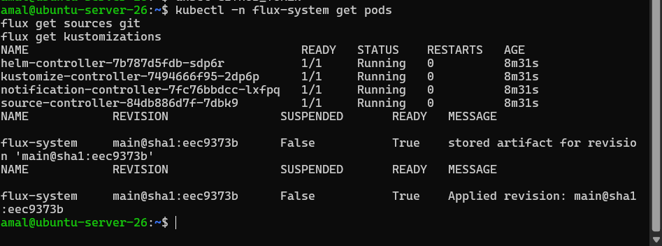
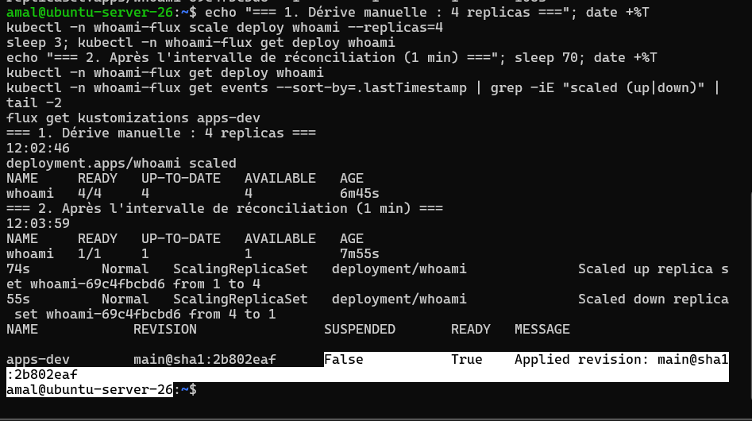
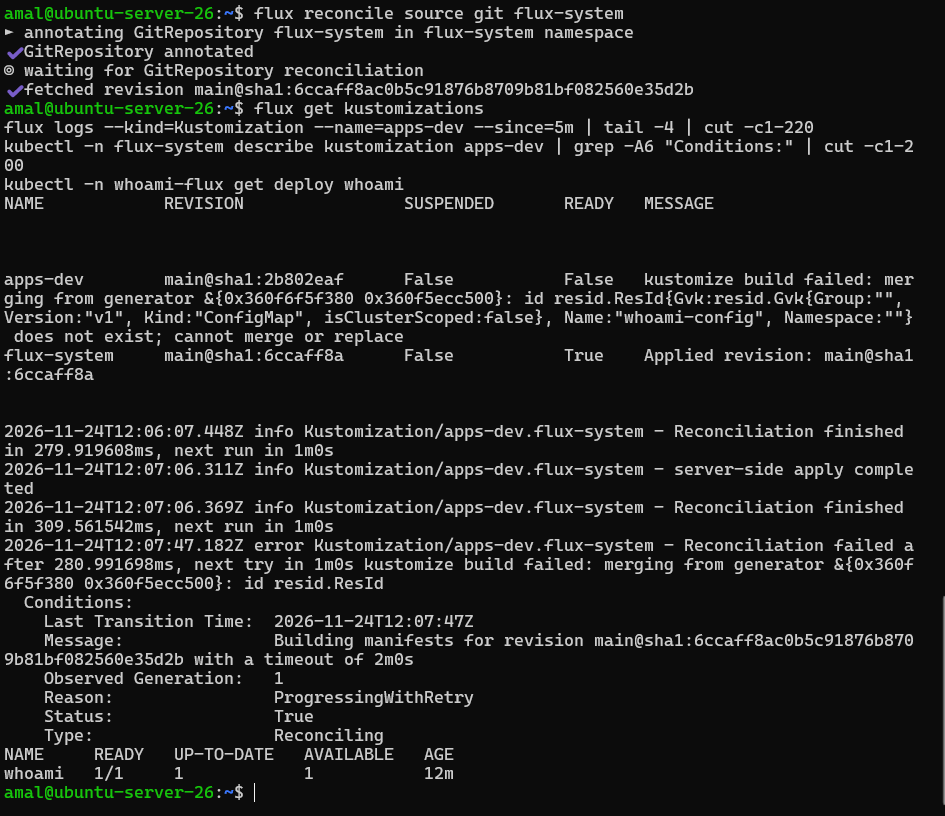
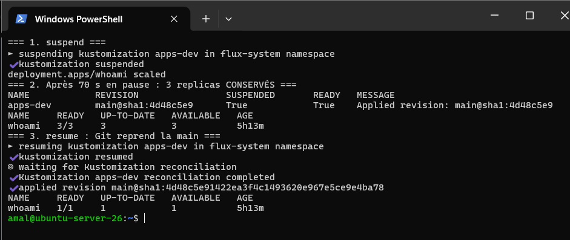
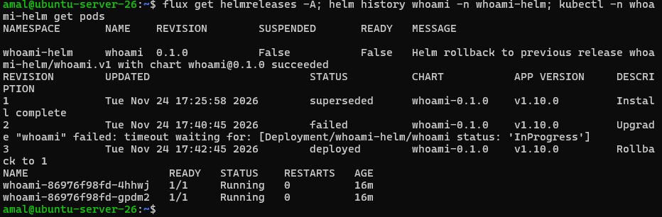

# TP20 : GitOps avec Flux CD (et comparaison avec Argo CD)

> **Cours** : DevOps & Cloud, M. Wahid ([énoncé](https://docs.teknolabs.net/courses/devops-cloud/partie-7-gitops/tp20-gitops-flux/))
> **Étudiante** : Amal Jemli, Master DevOps
> **Dépôt GitOps** : [github.com/Amal356/tp20-flux](https://github.com/Amal356/tp20-flux) (créé par `flux bootstrap`)
> **Objectif** : déployer les mêmes applications qu'au TP19, mais avec **Flux** (contrôleurs Kubernetes et ressources `GitRepository`, `Kustomization`, `HelmRelease`, sans interface graphique), puis comparer Argo CD et Flux sur des faits.

## Sommaire
1. [Environnement](#1-environnement)
2. [Partie 1 : bootstrap](#2-partie-1--bootstrap)
3. [Partie 2 : application Kustomize, dérive, erreur](#3-partie-2--application-kustomize-dérive-erreur)
4. [Partie 3 : suspendre, reprendre, prune](#4-partie-3--suspendre-reprendre-prune)
5. [Partie 4 : HelmRelease](#5-partie-4--helmrelease)
6. [Partie 5 : comparaison Argo CD / Flux](#6-partie-5--comparaison-argo-cd--flux)
7. [Difficultés rencontrées](#7-difficultés-rencontrées)
8. [Sécurité](#8-sécurité)
9. [Livrables](#9-livrables)

---

## 1. Environnement

| Élément | Valeur |
|---|---|
| Cluster | K3s v1.34.12+k3s1, mono-nœud (VM de lab partagée avec d'autres activités) |
| Argo CD | toujours présent (TP19 et autre projet) : Flux gère **d'autres namespaces** (`whoami-flux`, `whoami-helm`). Deux outils GitOps ne doivent jamais gérer les mêmes ressources |
| Fichiers | `flux-starter-complet/` : starter du cours avec les TODO complétés, et chart `whoami` du TP15 copié dans `charts/whoami/` |
| Flux | CLI et contrôleurs **v2.9.6** (la v2.10.1 exige Kubernetes ≥ 1.35, alors que le cluster est en 1.34.12) |


## 2. Partie 1 : bootstrap

```bash
curl -s https://fluxcd.io/install.sh | sudo FLUX_VERSION=2.9.6 bash     # empreinte vérifiée par l'installateur
flux check --pre                              # ✔ Kubernetes 1.34.12+k3s1 >=1.33.0-0 / prerequisites checks passed
read -rsp "Jeton GitHub (flux-tp20): " GITHUB_TOKEN; echo; export GITHUB_TOKEN    # saisi sans affichage
flux bootstrap github --owner=Amal356 --repository=tp20-flux --branch=main --path=clusters/lab --personal
unset GITHUB_TOKEN
```

Sortie du bootstrap (extrait) :
```text
✔ cloned repository
✔ committed component manifests to "main" ("04ace01…")
► installing components in "flux-system" namespace
✔ installed components
► generating source secret
✔ public key: ecdsa-sha2-nistp384 AAAA…
✔ configured deploy key "flux-system-main-flux-system-./clusters/lab" for "https://github.com/Amal356/tp20-flux"
✔ committed sync manifests to "main" ("eec9373…")
✔ GitRepository reconciled successfully
✔ Kustomization reconciled successfully
✔ helm-controller / kustomize-controller / notification-controller / source-controller: deployment ready
✔ all components are healthy
```



**Ce que le bootstrap a écrit dans le dépôt** (`clusters/lab/flux-system/`) :

| Fichier | Contenu |
|---|---|
| `gotk-components.yaml` | les manifests de Flux lui-même : CRD, les 4 contrôleurs, RBAC, NetworkPolicies (commit `04ace01`) |
| `gotk-sync.yaml` | un `GitRepository` `flux-system` (ce dépôt, branche `main`, via SSH) et une `Kustomization` `flux-system` qui applique `./clusters/lab` (commit `eec9373`) |
| `kustomization.yaml` | regroupe les deux fichiers |

- **Flux se gère lui-même en GitOps** : il s'est installé à partir de ces fichiers. Une mise à jour de Flux se fait par un commit (nouveau `gotk-components.yaml`).
- **Les 4 contrôleurs** : `source-controller` (récupère Git, Helm, OCI et produit des artefacts), `kustomize-controller` (applique les manifests et Kustomize, prune, health checks), `helm-controller` (installe et met à jour les releases Helm, remédiation), `notification-controller` (alertes sortantes et webhooks entrants).

**Rôle de la clé de déploiement** (*Settings → Deploy keys*) : le bootstrap a généré une paire de clés SSH ; la **clé privée** est restée dans le cluster (Secret `flux-system/flux-system`), la **clé publique** a été déposée sur le dépôt comme *deploy key*. Flux s'authentifie ensuite avec cette clé, **limitée à ce seul dépôt** et en lecture seule par défaut. Le jeton personnel (PAT fine-grained, limité à `tp20-flux`, Contents et Administration, 7 jours) n'a servi **qu'au bootstrap** (création des commits et de la deploy key) : il n'est stocké nulle part dans le cluster et peut être révoqué.

## 3. Partie 2 : application Kustomize, dérive, erreur

```yaml
# clusters/lab/apps.yaml (TODO complétés)
apiVersion: kustomize.toolkit.fluxcd.io/v1
kind: Kustomization
metadata: { name: apps-dev, namespace: flux-system }
spec:
  interval: 1m
  sourceRef: { kind: GitRepository, name: flux-system }
  path: ./apps/dev
  prune: true      # ressources retirées de Git => supprimées du cluster
  wait: true       # Ready seulement quand les ressources sont prêtes (health checks)
  timeout: 2m
```

```bash
# Windows : git clone tp20-flux, copie du starter complété (sans toucher à clusters/lab/flux-system/), commit, push -> 2b802ea
flux reconcile source git flux-system      # ✔ fetched revision main@sha1:2b802eaf
flux get kustomizations                    # apps-dev / flux-system : READY True, Applied revision: main@sha1:2b802eaf
kubectl -n whoami-flux get all             # namespace, Service, Deployment whoami 1/1
```
- `clusters/lab/apps.yaml` est lui-même appliqué par la Kustomization `flux-system` (elle applique tout `clusters/lab/`), et il crée la Kustomization `apps-dev` qui applique `apps/dev`. C'est le schéma courant **« app of apps »** de Flux.
- Le namespace `whoami-flux` est créé par le manifest `apps/dev/namespace.yaml` (Argo CD le faisait avec l'option `CreateNamespace=true`).

### Dérive

```bash
kubectl -n whoami-flux scale deploy whoami --replicas=4      # 12:02:46
sleep 70; kubectl -n whoami-flux get deploy whoami           # 12:03:59 -> 1/1
```



- À 12:02:46, la dérive manuelle passe le Deployment à **4/4**. Les événements montrent `Scaled up … from 1 to 4`, puis `Scaled down … from 4 to 1` **19 s plus tard**, à la réconciliation suivante d'`apps-dev`. La Kustomization reste sur `main@sha1:2b802eaf` : **Git fait foi**.
- **Différence avec Argo CD** : au TP19, le self-heal a corrigé en **moins d'une seconde**, car le contrôleur d'Argo CD **surveille** les ressources (*watch*) et réagit à chaque événement. Flux réapplique l'état de Git **périodiquement** (`interval: 1m`, server-side apply) : la dérive peut donc durer **jusqu'à un intervalle**. On réduit l'intervalle pour corriger plus vite, au prix de plus d'appels à l'API.
- Avec Flux, la correction de dérive est le comportement **par défaut** de toute Kustomization ; avec Argo CD, il faut activer `selfHeal: true`.

### Erreur et diagnostic

Faute volontaire poussée dans `apps/dev/kustomization.yaml` : `ressources:` au lieu de `resources:` (commit `6ccaff8`).

```bash
flux reconcile source git flux-system          # ✔ fetched revision main@sha1:6ccaff8a
flux get kustomizations
flux logs --kind=Kustomization --name=apps-dev --since=5m
kubectl -n flux-system describe kustomization apps-dev
```



- `apps-dev` passe en **`READY False`**, avec `kustomize build failed: merging from generator … Kind:"ConfigMap" … Name:"whoami-config" does not exist; cannot merge or replace`. Avec `ressources` mal orthographié, la base `../base` n'est plus incluse : le `configMapGenerator` en `behavior: merge` ne trouve plus le ConfigMap de base à fusionner. L'erreur réelle est donc **une conséquence** de la faute, et il faut remonter à la cause.
- Pendant ce temps, la **révision appliquée reste `2b802eaf`** (dernière bonne) et l'application continue de tourner (`whoami 1/1`) : **un build en échec n'applique rien**. Il n'y a pas d'état à moitié appliqué.
- `flux-system` est en `READY True` sur `6ccaff8a` : la source Git a bien été récupérée, c'est seulement le **build** d'`apps-dev` qui échoue. Les deux niveaux (source / application) se diagnostiquent séparément.
- **Outils de diagnostic Flux** (pas d'interface graphique) : `flux get kustomizations` (statut et message), `flux logs --kind=Kustomization --name=apps-dev` (journaux du kustomize-controller : `Reconciliation failed … next try in 1m0s`), `kubectl describe kustomization` (conditions `Ready` / `Reconciling`, raison `ProgressingWithRetry`). Flux **réessaie** toutes les minutes jusqu'à la correction.
- En amont, `kustomize build apps/dev` ou `flux build kustomization` en CI aurait détecté l'erreur **avant** le merge.

## 4. Partie 3 : suspendre, reprendre, prune

### 4.1 Correction de l'erreur

```powershell
git revert --no-edit HEAD    # annule 6ccaff8 (champ `ressources`)
git push
```
```bash
flux reconcile source git flux-system && sleep 15 && flux get kustomizations
```
Nouvelle révision `main@sha1:4d48c5e9`. Pendant quelques secondes, `READY Unknown / Reconciliation in progress` : avec `wait: true`, Flux attend que les ressources soient prêtes avant de passer `True`.

### 4.2 Suspendre / reprendre

```bash
flux suspend kustomization apps-dev
kubectl -n whoami-flux scale deploy whoami --replicas=3
sleep 70
flux get kustomizations apps-dev; kubectl -n whoami-flux get deploy whoami
flux resume kustomization apps-dev
sleep 5; kubectl -n whoami-flux get deploy whoami
```



| Moment | `SUSPENDED` | Replicas | Explication |
|---|---|---|---|
| Après `suspend` + scale manuel, 70 s plus tard | `True` | **3/3** | Plus d'une période de réconciliation (`interval: 1m`) s'est écoulée : Flux n'a **rien corrigé** |
| Après `resume` | `False` | **1/1** | `resume` déclenche immédiatement une réconciliation : `applied revision main@sha1:4d48c5e9`, Git reprend la main |

**Analyse :**
- `suspend` sert pendant une **maintenance** ou un **incident** : on peut intervenir à la main (scale, patch, debug) sans que Flux annule les changements.
- Le champ `READY True` reste affiché pendant la pause : il décrit la **dernière** réconciliation, pas l'état actuel. C'est `SUSPENDED True` qu'il faut surveiller, sinon une application peut rester « oubliée » en pause.
- Tout changement fait pendant la pause est **perdu** au `resume` s'il n'a pas été reporté dans Git : Git reste la seule source de vérité.
- Équivalent Argo CD : désactiver l'`automated` sync de l'Application.

### 4.3 Prune

`prune: true` dans `clusters/lab/apps.yaml` : une ressource **retirée de Git** est **supprimée du cluster**.

```powershell
# tp20-flux : retrait de service.yaml de apps/base/kustomization.yaml
(Get-Content apps\base\kustomization.yaml) | Where-Object { $_ -notmatch 'service.yaml' } | Set-Content apps\base\kustomization.yaml
git commit -am "test prune : retrait du Service"; git push      # e1fd99c
```
```bash
flux reconcile kustomization apps-dev --with-source && kubectl -n whoami-flux get deploy,svc
```

| Étape | Révision | Deployment | Service `whoami` |
|---|---|---|---|
| Avant | `4d48c5e9` | 1/1 | ClusterIP `10.43.248.190`, âge 5h22m |
| Après retrait de `service.yaml` | `e1fd99c6` | 1/1 | **supprimé** |
| Après `git revert` | `f1fccd22` | 1/1 | **recréé** : ClusterIP `10.43.138.178`, âge 4s |

**Analyse :**
- Flux garde l'inventaire des objets qu'il a appliqués (`status.inventory` de la Kustomization). Un objet présent dans l'inventaire mais absent du nouveau build est supprimé : **le cluster reflète exactement Git**, sans ressources orphelines.
- Le Service recréé a une **nouvelle ClusterIP** : un objet supprimé puis recréé est un objet **neuf**. C'est pour cela que les applications doivent passer par le **nom DNS** (`whoami.whoami-flux.svc`), jamais par l'IP.
- Danger : sans relecture, une ligne supprimée par erreur dans Git supprime la ressource en production. Pour une ressource à protéger (PVC, namespace…), on peut ajouter l'annotation `kustomize.toolkit.fluxcd.io/prune: disabled`.
- Retour arrière = `git revert` : l'historique Git garde la trace de l'erreur **et** de sa correction.

## 5. Partie 4 : HelmRelease

### 5.1 Installation du chart par Flux

Le fichier `clusters/lab/helm-whoami.yaml` (Namespace `whoami-helm` + `HelmRelease`) était nommé `.disabled` pour que Flux l'ignore. Il est activé par un simple renommage dans Git :

```powershell
git mv clusters\lab\helm-whoami.yaml.disabled clusters\lab\helm-whoami.yaml
git commit -m "TP20 : HelmRelease whoami"; git push
```
```bash
flux reconcile kustomization flux-system --with-source
flux get helmreleases -A; helm list -n whoami-helm; kubectl -n whoami-helm get pods
```

```yaml
spec:
  chart:
    spec:
      chart: ./charts/whoami          # chart du TP15, lu dans le dépôt Git
      sourceRef: {kind: GitRepository, name: flux-system, namespace: flux-system}
  timeout: 2m                         # équivalent de helm --wait --timeout 2m
  values:
    replicaCount: 2
    env: {WHOAMI_NAME: whoami-flux-helm}
    ingress: {enabled: true, host: whoami-flux.lab.local}
  upgrade:
    remediation:
      retries: 2
      strategy: rollback
```

Résultat : `READY True`, `Helm install succeeded for release whoami-helm/whoami.v1 with chart whoami@0.1.0`, `helm list` → révision **1** `deployed` (`whoami-0.1.0`, app `v1.10.0`), **2 pods** `Running` (la valeur `replicaCount: 2` du HelmRelease remplace le `1` du `values.yaml`). Aucune commande `helm install` n'a été tapée : c'est le **helm-controller** qui l'exécute.

### 5.2 Échec volontaire et remédiation automatique

Ajout dans les `values` d'un tag d'image **inexistant** :
```yaml
    image:
      tag: v9.9.9   # ERREUR VOLONTAIRE (TP20) : tag inexistant
```
```bash
flux get helmreleases -A; helm history whoami -n whoami-helm; kubectl -n whoami-helm get pods
```



| Révision | Statut | Description |
|---|---|---|
| 1 | `superseded` | Install complete (v1.10.0) |
| 2 | `failed` | `Upgrade "whoami" failed: timeout waiting for: [Deployment/whoami-helm/whoami status: 'InProgress']` |
| 3 | `deployed` | **Rollback to 1** (automatique) |

**Déroulement observé :**
1. Révision 2 en `pending-upgrade` : le nouveau pod `whoami-856fb75c5-…` est en **`ImagePullBackOff`** (l'image `traefik/whoami:v9.9.9` n'existe pas).
2. Pendant ce temps, les **2 anciens pods restent `Running`** : le *rolling update* ne retire pas les anciens pods tant que le nouveau n'est pas prêt → **aucune coupure**.
3. Au bout de `timeout: 2m`, Helm marque la révision 2 `failed`.
4. Flux applique la **remédiation** `strategy: rollback` : révision 3 = `Rollback to 1`, le pod cassé disparaît. Le HelmRelease affiche `READY False` / `Helm rollback to previous release … succeeded` : l'**application** est saine, mais l'**état voulu dans Git** (v9.9.9) n'est pas atteint, ce qui doit alerter.

**Analyse :**
- Sans remédiation, la release resterait `failed` et chaque correction exigerait une intervention manuelle (`helm rollback`).
- La remédiation **ne corrige pas Git** : tant que `v9.9.9` est dans le dépôt, Flux retente (jusqu'à `retries: 2`). La vraie correction est un `git revert` du commit fautif.
- Différence avec Argo CD : Argo CD fait un `helm template` puis applique les manifestes (pas de release Helm, pas de `helm history`) ; Flux utilise le vrai **SDK Helm** (releases, hooks, rollback natif).

### 5.3 Correction

```powershell
git revert --no-edit HEAD; git push       # retire le tag v9.9.9
```
```bash
flux reconcile kustomization flux-system --with-source
flux reconcile helmrelease whoami -n whoami-helm --force   # relance après épuisement des tentatives
flux get helmreleases -n whoami-helm                        # READY True
```

## 6. Partie 5 : comparaison Argo CD / Flux

Comparaison établie à partir de ce qui a été **fait** dans les TP19 et TP20 sur le même cluster.

| Critère | Argo CD (TP19) | Flux (TP20) |
|---|---|---|
| **Architecture** | Application monolithique : API server, repo-server, application-controller, Redis, Dex (≈ 7 pods) | Ensemble de contrôleurs indépendants : source, kustomize, helm, notification (4 pods), composables |
| **Interface** | **UI web** riche (arbre des ressources, diff, historique, bouton Sync) + CLI `argocd` | **Pas d'UI** native : CLI `flux` et `kubectl` (UI possible via outils tiers) |
| **Installation / bootstrap** | Helm ou manifest, puis on déclare les `Application` (Argo ne se gère pas lui-même par défaut) | `flux bootstrap` : installe Flux **et** l'écrit dans Git → Flux se gère lui-même en GitOps |
| **Modèle de ressources** | `Application`, `ApplicationSet`, `AppProject` | `GitRepository`, `Kustomization`, `HelmRelease`, `HelmRepository`… (source séparée de l'application) |
| **Dérive (self-heal)** | `selfHeal: true` : correction quasi immédiate (surveillance du cluster) | Correction à chaque `interval` (1 min ici) |
| **Helm** | `helm template` + apply : pas de vraie release Helm | **SDK Helm** natif : releases, `helm history`, hooks, **rollback automatique** (remédiation) |
| **Multi-environnements** | `ApplicationSet` (générateur de répertoires, `templatePatch` : prod en sync manuelle) | Une `Kustomization` par environnement / overlay ; `dependsOn` pour ordonner |
| **Multi-tenant / RBAC** | `AppProject` + RBAC et SSO propres à Argo CD | RBAC **Kubernetes** natif (`serviceAccountName` par Kustomization), pas de couche d'auth à part |
| **Diagnostic d'erreur** | Visible dans l'UI (statut `Degraded`, `SyncFailed`, diff) | `flux get`, `flux logs`, `kubectl describe` : plus austère mais scriptable |
| **Pause** | Désactiver l'`automated` sync de l'Application | `flux suspend` / `flux resume` |

### Recommandations

**a) Équipe qui veut une interface visuelle partagée (développeurs, support, démos) → Argo CD.**
L'UI montre en un coup d'œil l'état de chaque application, le diff avec Git et l'historique ; les développeurs peuvent suivre leurs déploiements sans accès `kubectl`. L'`AppProject` et le SSO intégrés permettent de donner une vue limitée à chaque équipe. C'est ce qui a rendu le TP19 (self-heal, promotion, revert) facile à observer.

**b) 100 clusters autonomes (edge, sites distants, multi-régions) → Flux.**
Chaque cluster porte son propre Flux, léger (4 contrôleurs, pas de base Redis ni d'UI à exposer), **bootstrappé depuis Git** et capable de se mettre à jour lui-même. Il n'y a pas de point central à joindre ni de port entrant : chaque cluster **tire** sa configuration (`clusters/<nom>/`), même avec une connectivité intermittente. Le RBAC Kubernetes natif suffit, sans SSO à maintenir sur 100 instances.

Les deux outils peuvent cohabiter (cas de ce TP), à condition de **ne jamais gérer les mêmes ressources** avec les deux.

## 7. Difficultés rencontrées

| Problème | Cause | Solution |
|---|---|---|
| `flux check --pre` : `✗ Kubernetes version v1.34.12+k3s1 does not match >=1.35.0-0` | Flux 2.10 ne supporte que Kubernetes 1.35 à 1.37 | CLI et contrôleurs en **Flux 2.9.6** (supporte Kubernetes 1.34) via `FLUX_VERSION=2.9.6`, plutôt que de mettre à jour K3s (VM partagée) |
| VM « Avortée » dans VirtualBox, SSH coupé (`Connection reset`) | VM configurée avec 10 Go de RAM, mémoire insuffisante côté Windows | Programmes inutiles fermés, VM redémarrée en mode sans affichage ; K3s et les applications sont revenus seuls |

## 8. Sécurité

| Mesure | Mise en œuvre |
|---|---|
| Jeton GitHub minimal | PAT *fine-grained* `flux-tp20` : **un seul dépôt** (`tp20-flux`), droits Contents + Administration, **expiration 7 jours** ; utilisé une seule fois pour le bootstrap |
| Jeton jamais exposé | Saisi avec `read -rsp` (pas d'écho, pas d'historique), puis `unset GITHUB_TOKEN` |
| Accès durable du cluster | `flux bootstrap` crée une **deploy key SSH** propre au dépôt (Secret `flux-system/flux-system`) : en **lecture seule**, révocable dans GitHub sans toucher au compte |
| Modèle pull | Le cluster tire depuis GitHub : aucun port entrant, aucun identifiant du cluster dans la CI |
| Versions épinglées | Flux **2.9.6** (`FLUX_VERSION`), chart `whoami@0.1.0`, image `traefik/whoami:v1.10.0` (jamais `latest`) |
| Chart durci (TP15) | `runAsNonRoot`, `readOnlyRootFilesystem`, `drop: ALL`, `seccompProfile: RuntimeDefault`, limites CPU/mémoire, `values.schema.json` |
| Isolation | Namespaces dédiés `whoami-flux` / `whoami-helm` ; Flux ne touche pas aux applications gérées par Argo CD |
| Garde-fous | `prune` limité à l'inventaire de chaque Kustomization ; remédiation Helm `rollback` ; `wait: true` + `timeout` pour détecter un déploiement cassé |
| Aucun secret dans Git | Vérifié avant chaque commit (`git status --short \| Select-String "\.key\|kubeconfig\|k3s\.yaml"` vide) ; `kubeconfig` jamais copié |
| Nettoyage | PAT `flux-tp20` à supprimer après le TP (ou laissé expirer) ; deploy key à révoquer si le dépôt est abandonné |

## 9. Livrables

| Capture | Contenu | État |
|---|---|---|
| `captures/flux-bootstrap.png` | `flux bootstrap` puis `flux get kustomizations` | ✅ |
| `captures/flux-drift.png` | Replicas modifiés à la main puis rétablis par Flux | ✅ |
| `captures/flux-error.png` | Diagnostic d'une Kustomization en erreur (`flux logs`) | ✅ |
| `captures/flux-suspend.png` | `flux suspend` / `flux resume` | ✅ |
| `captures/helmrelease.png` | `flux get helmreleases` et `helm history` avec remédiation | ✅ |

Dépôt Flux : [github.com/Amal356/tp20-flux](https://github.com/Amal356/tp20-flux) · tableau comparatif : section 6.
